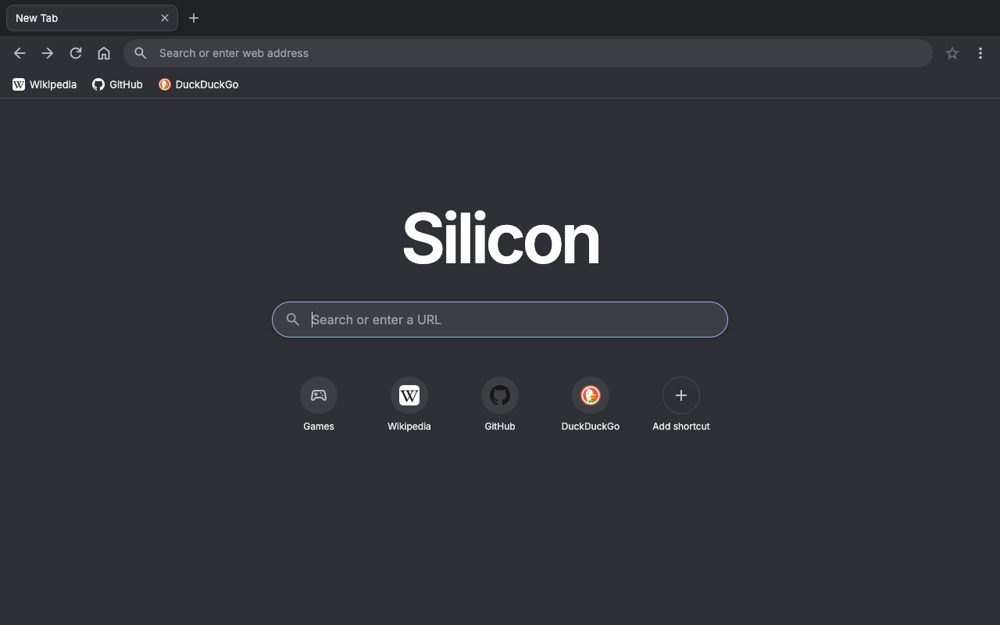
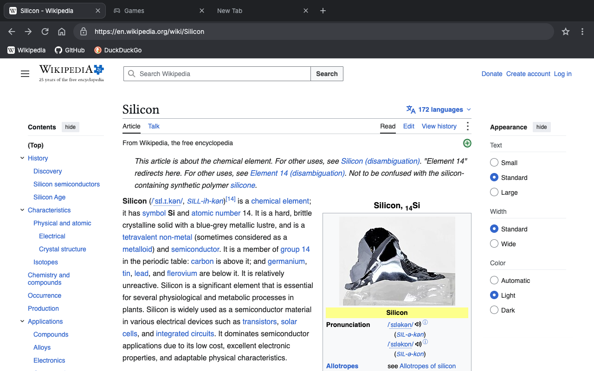
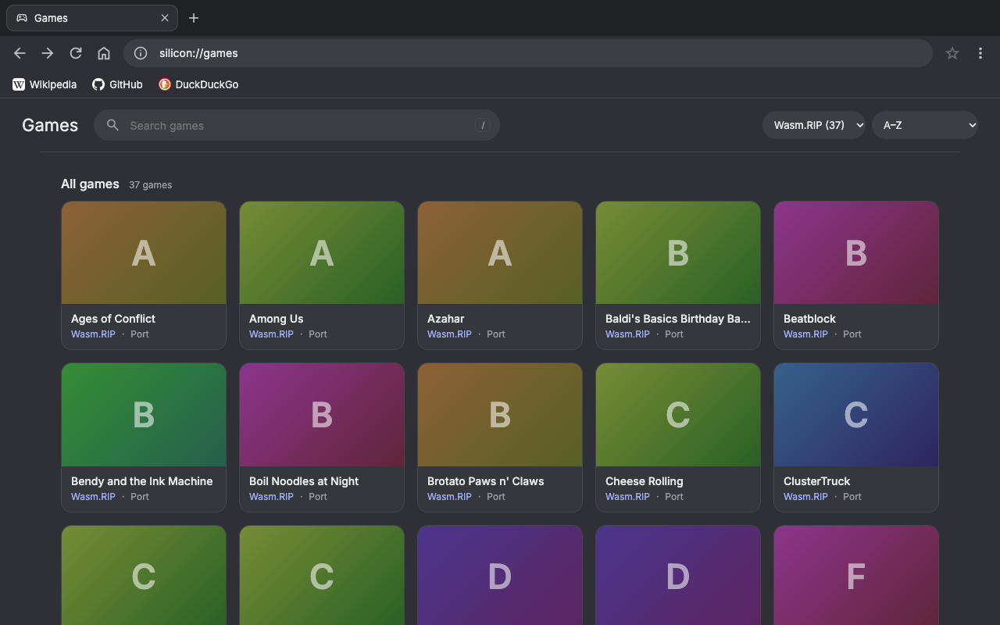
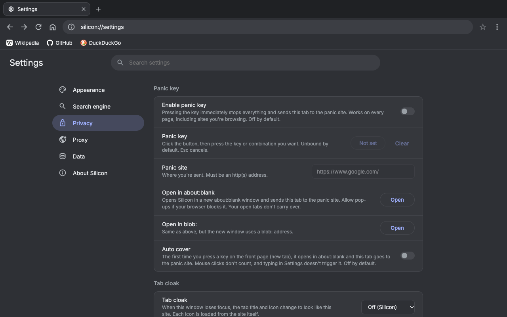

# Silicon

**Browse the web and play games from one tab.**

[](LICENSE)
[](https://nodejs.org/)


An open-source browser-in-a-tab and games launcher. You run it on your own computer or server, open it in any modern browser, and get tabs, bookmarks, history and a library of browser games, with sites and games loaded through the [Scramjet](https://github.com/MercuryWorkshop/scramjet) 2 web proxy. Express + Scramjet + a Wisp server in one process, with a vanilla HTML/CSS/JS frontend and no build step.

Source code: <https://github.com/Carbonine/silicon>

> **Experimental (v0.3 beta).** Silicon is early software. Expect rough edges, missing features and things that break when a website, a game source or the proxy changes. Don't rely on it for anything important, and don't enter passwords or other sensitive data on sites you reach through it unless you trust where it is hosted. See [Known limitations](docs/GUIDE.md#known-limitations).

| | |
| --- | --- |
|  |  |
|  |  |

*The games screenshot has the sources' cover art turned off.*

## Why use Silicon

- **You run it, so you control it.** No accounts, no ads, no analytics. Your settings, bookmarks, history and favorites stay in your own browser.
- **Browser and games in one place.** Browse the web and play games from one tab, with games from several sources collected in a single library.
- **Built for networks that block things.** Sites and games load through your own server's proxy, so a blocked game site or website can still work if your server can reach it.
- **Quick to hide.** A panic key, tab cloaking and cover windows are built in.
- **Small and simple.** One process, one `npm install`, no build step, no database. Games are fetched live and never saved to disk.
- **Free software.** AGPL-3.0, so you can read it, change it and share it.

## Features

- **Browser:** tabs you can drag, duplicate and reopen, an address bar with suggestions from your own bookmarks and history, find in page, per-site zoom, downloads, and links that open as new tabs. Dark, light or system theme, and your choice of search engine.
- **Bookmarks and history:** a bookmarks bar, a manager and a history page, all kept in your browser. History can be turned off.
- **Games:** a library fed live by several [game sources](docs/GUIDE.md#game-sources), with search, categories, favorites and "continue playing". The player can load a game through the proxy or directly, and game saves can be exported and imported.
- **Privacy and stealth:** a panic key, tab cloaking that makes the tab look like another site, cover windows, and a confirm-before-leaving option.
- **Proxy:** Scramjet 2 with the Epoxy or libcurl transport, an optional upstream SOCKS5 or HTTP proxy, and the option to use another Wisp server.

See the [keyboard shortcuts](docs/GUIDE.md#keyboard-shortcuts) for everything you can do without the mouse.

## Quick start

Requires [Node.js](https://nodejs.org/) 18 or newer and git.

```sh
git clone https://github.com/Carbonine/silicon.git silicon
cd silicon
npm install
npm run dev
```

Then open <http://localhost:3000>.

- `npm run dev` starts everything in one process and restarts when files change. `npm start` runs the same server without the file watcher.
- No API keys or cloud accounts are needed.
- It listens on `127.0.0.1` by default, so only your own machine can reach it. This is the recommended way to run Silicon.
- A fresh clone gives you the newest code, which can be ahead of the latest release. To run a released version instead, see [Updating](docs/GUIDE.md#updating).

## Documentation

The [guide](docs/GUIDE.md) has the details:

- [Running it on a server (VPS)](docs/GUIDE.md#running-it-on-a-server-vps), step by step
- [Updating](docs/GUIDE.md#updating) and the [changelog](CHANGELOG.md)
- [Configuration](docs/GUIDE.md#configuration) and [keyboard shortcuts](docs/GUIDE.md#keyboard-shortcuts)
- [Game sources](docs/GUIDE.md#game-sources), [troubleshooting](docs/GUIDE.md#troubleshooting) and [known limitations](docs/GUIDE.md#known-limitations)
- [How it works](docs/GUIDE.md#how-it-works) and the [project layout](docs/GUIDE.md#project-layout)
- [The Next.js frontend](docs/GUIDE.md#the-nextjs-frontend), and what's planned in the [roadmap](ROADMAP.md)

## Contributing

Bug reports, ideas and pull requests are welcome. For anything big, please open an issue first. Everyone taking part is expected to follow the [Code of Conduct](CODE_OF_CONDUCT.md).

- **Reporting a problem:** say what you did, what you expected and what happened, plus your browser and whether you run Silicon on `localhost` or a server. For a game that won't load, try the shield button in the player first: if it fails both through the proxy and directly, it's the game's source, not Silicon.
- **Changing the code:** fork, branch and open a pull request. Silicon is plain HTML, CSS and JavaScript with no build step, so please keep it that way, match the code around your change, and check it in both themes. Don't add a dependency without talking about it first. Notable changes get a line in the [changelog](CHANGELOG.md) under "Unreleased".
- **Adding a game source:** see [Game sources](docs/GUIDE.md#game-sources).

By contributing you agree your work is released under the same AGPL-3.0 license as the rest of Silicon.

## Security

Silicon is a web proxy, so run it on `localhost` or behind access control (see [running it on a server](docs/GUIDE.md#running-it-on-a-server-vps)).

If you find a security problem, **please report it privately and don't open a public issue.** Use [**Report a vulnerability**](https://github.com/Carbonine/silicon/security/advisories/new) on the repository's Security tab. Problems inside Scramjet, Wisp or a transport belong with [Mercury Workshop](https://github.com/MercuryWorkshop), and a site that simply doesn't work through the proxy isn't a security issue. Silicon is a beta with no support schedule: fixes go into the latest version.

## License

Silicon is free software under the **GNU Affero General Public License v3.0** (AGPL-3.0-only). See [LICENSE](LICENSE). Copyright (C) 2026 Carbonine.

The AGPL applies to Silicon and requires that people who use a modified copy of it over a network can get that copy's source code. If you run a modified Silicon for other people, make your source available to them.

### Third-party software

Silicon is built on these projects, used under their own licenses:

| Project | License |
| --- | --- |
| [Scramjet](https://github.com/MercuryWorkshop/scramjet), scramjet-controller, scramjet-utils | AGPL-3.0 |
| Epoxy transport, libcurl transport | AGPL-3.0 |
| [wisp-js](https://github.com/MercuryWorkshop/wisp-js) | LGPL-3.0-or-later |
| proxy-transports | MIT |
| Express, compression | MIT |
| dotenv | BSD-2-Clause |
| [Material Symbols](https://github.com/marella/material-symbols) (icons) | Apache-2.0 |
| [Inter](https://rsms.me/inter/) via Fontsource (font) | SIL OFL 1.1 |

The proxy engine is by [Mercury Workshop](https://github.com/MercuryWorkshop). Silicon is not affiliated with or endorsed by them or by any of the game sources above.
